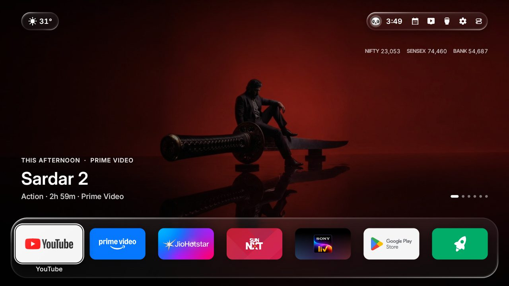
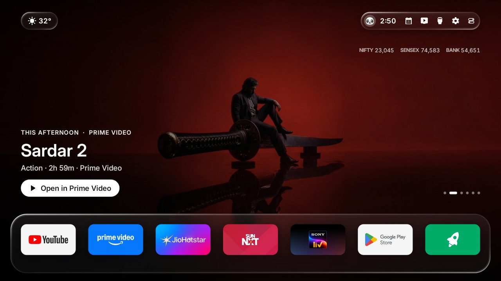
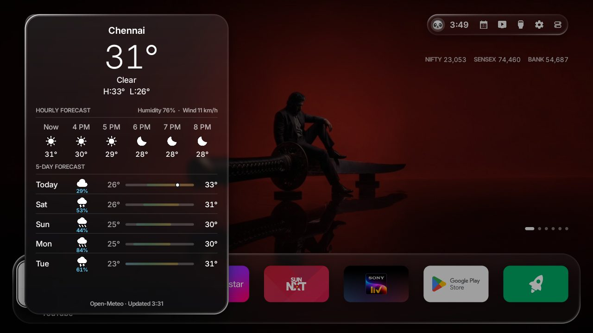
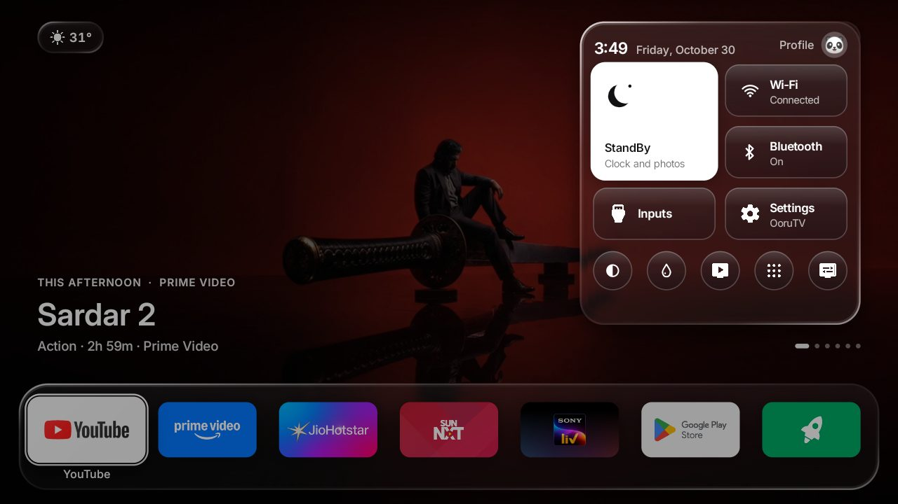
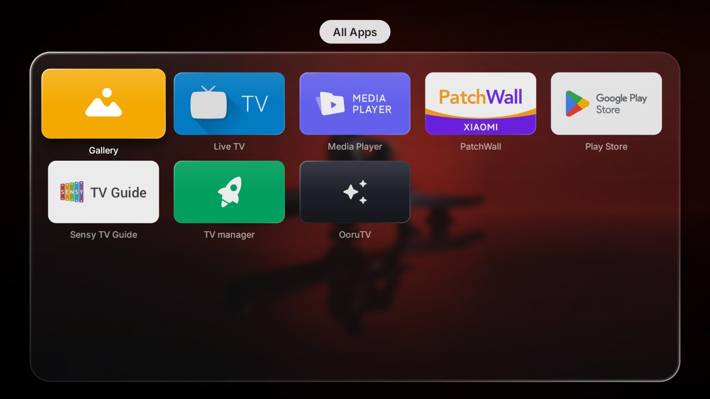
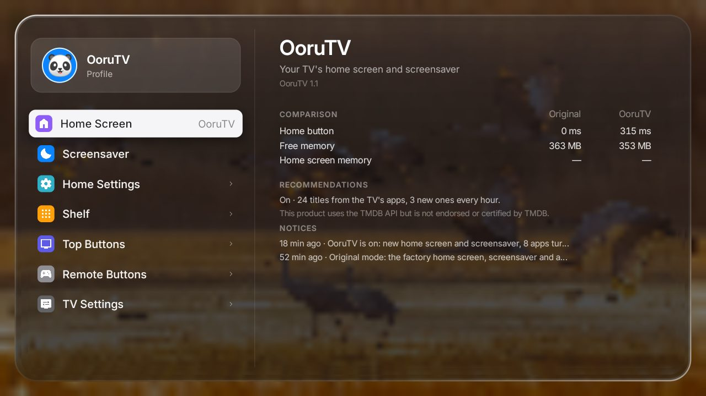
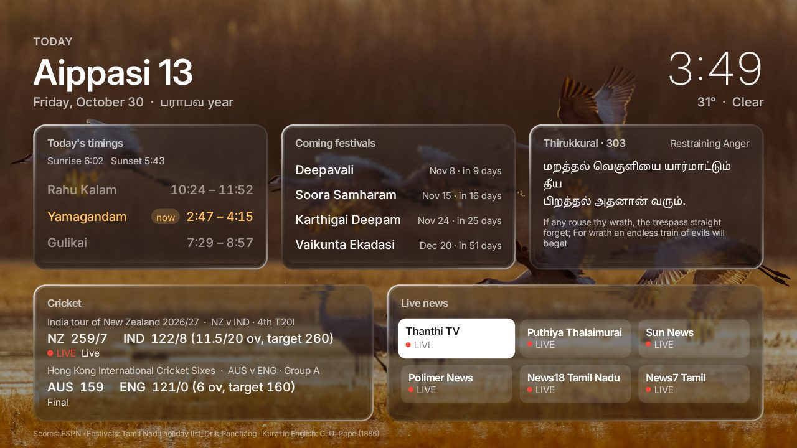

# OoruTV Launcher

**A calm, ad-free, tvOS-style home screen for Android TV and Google TV.**
Liquid Glass, a cinematic top shelf, Control Center, Apple-Weather-style forecasts, your own profile, and nothing
you didn't ask for. Plain Java, no libraries, about 1.5 MB, built for 60 fps on 1 GB TVs.



| Top shelf, focused | Weather | Control Center |
|---|---|---|
|  |  |  |
| **All Apps** | **Settings** | **Today** |
|  |  |  |

*Screenshots from a Mi TV 4i (Android 9) in Chennai.*

---

## Contents

- [What you get](#what-you-get)
- [Liquid Glass on every TV](#liquid-glass-on-every-tv)
- [Install](#install)
- [Using it with the remote](#using-it-with-the-remote)
- [Settings](#settings)
- [Going back to the TV's own home screen](#going-back-to-the-tvs-own-home-screen)
- [What it changes on the TV](#what-it-changes-on-the-tv)
- [Build from source](#build-from-source)
- [How it works](#how-it-works)
- [Project layout](#project-layout)
- [Translations](#translations)
- [Privacy](#privacy)
- [Troubleshooting](#troubleshooting)
- [Roadmap](#roadmap)
- [License](#license)

---

## What you get

**Home screen (tvOS style)**
- **Top shelf**: a movie or show picked for this time of day fills the screen, with its service, title, year, genre,
  runtime, ★ rating and a two-line synopsis. It moves on by itself every 15 seconds; dots show where you are.
  Press **↑** to focus it, **← →** to browse, **OK** to open it straight in its app.
- **App dock**: your streaming apps on a Liquid Glass shelf, each in its brand colours. The focused app grows, shows
  its name and catches a streak of light. Hold **OK** to move an app.
- **Weather pill** (top left): the current conditions. Open it for an Apple-Weather-style panel: temperature, high and
  low, humidity and wind, the next hours, and a 5-day outlook with colour range bars and rain chances.
- **Status pill** (top right): your avatar, the clock and round glass buttons (Today, Live TV, Inputs, Settings,
  Control Center). The focused one turns white with dark ink and shows its name.
- **Control Center** (the remote's **Menu** key, or the last round button): StandBy, Wi-Fi and Bluetooth status,
  Inputs, Settings, Dark Mode, Glass Style, Live TV, All Apps and the TV's own settings, under the time,
  the date and your profile.
- **Profile**: a name and one of ten emoji avatars, shown in the status pill and Control Center.
- **Bottom drawer** (**↓** from the apps): HDMI inputs and Live TV, shortcuts, today's weather with air quality, and
  market quotes (NIFTY 50, SENSEX, BANK NIFTY, or crypto) with the day's change.
- **All Apps**: every app in a Liquid Glass box under a light name pill, as glossy tiles with a diagonal glass rim;
  the focused one rises, catches a streak of light and shows its name.
- **Settings** in the tvOS split view: a Liquid Glass window over today's photo, your profile at the top of the
  sidebar, each section with its coloured icon, and content rows on their own glass plates with the white focus.
- **Today** page (date, Panchang, Thirukkural, cricket, news) over today's photo, with Liquid Glass cards.
- **Dark Mode**: on, off, or automatically from sunset to sunrise at your location.

**Screensaver**: Bing's photo of the day (or the picks' photos) with a slow Ken Burns zoom, a big Liquid Glass clock,
the date, weather and quotes, and a Thirukkural couplet.

**Made for India, works anywhere**: Tamil, Hindi and 20+ other languages, Tamil titles first in the picks, Indian
streaming apps on the dock (JioHotstar, Sun NXT, SonyLIV, Prime Video, Netflix, YouTube), rupee prices.

**No ads, no tracking, no account.** Nothing is sent anywhere except the requests listed under [Privacy](#privacy).

---

## Liquid Glass on every TV

OoruTV picks the best glass your TV's GPU can draw, automatically:

| TV | What you see |
|---|---|
| **Android 13 and newer** (most 2023+ Google TVs) | Full **Liquid Glass**, a per-pixel GPU shader (AGSL): the picture behind bends at the bevel of each glass shape with a power-law falloff, splits slightly into colour at the edge (dispersion), gets richer colour (×1.25 saturation), and a bright hairline catches the light from the top left with a softer echo on the far side. |
| **Android 8 to 12** | The same look drawn with plain Canvas: the photo seen through the glass, then a **lens rim** (the background redrawn magnified along the edge in two passes, so it is pulled in from beyond it), the tint, and diagonal tvOS-style highlights. No layers, no masks, so even a Mali-450 keeps 60 fps. |

Prefer softer glass? **Control Center → Glass Style → Frosted Glass** turns the bending off everywhere.

Install the same APK on any TV: the Android 13+ effects switch on by themselves.

---

## Install

### The easy way: let an AI assistant do it

Open this folder in Claude Code (or a similar coding assistant) and say *"Install OoruTV on my TV"*. It reads
[CLAUDE.md](CLAUDE.md), checks your tools, asks for your city and TV, builds and installs. You only press OK on the TV.

### The manual way

**1. Turn on ADB debugging on the TV**
- Settings → Device Preferences → About → select **Build** seven times ("You are now a developer").
- Settings → Device Preferences → Developer options → turn on **USB debugging** (and **Network debugging** /
  **ADB debugging** if your TV has it).
- Note the TV's IP address: Settings → Network & Internet → your Wi-Fi.

**2. Get the tools** (a JDK 17+, the Android SDK build tools 34 with platform android-34, and adb)

| | |
|---|---|
| **Windows** | Install [Temurin JDK 17](https://adoptium.net), [Git for Windows](https://git-scm.com) (for Git Bash), and Android's [command-line tools](https://developer.android.com/studio#command-tools). Then in a terminal: `sdkmanager "build-tools;34.0.0" "platforms;android-34" "platform-tools"` |
| **macOS** | `brew install --cask temurin android-commandlinetools android-platform-tools`, then `sdkmanager "build-tools;34.0.0" "platforms;android-34"` |
| **Linux** | OpenJDK 17, Android's command-line tools and adb from your package manager, then the same `sdkmanager` line |

Set `ANDROID_HOME` if `build.sh` can't find the SDK.

**3. Build**
```bash
git clone https://github.com/NonStopProgrammer/OoruTV-Launcher.git
cd OoruTV-Launcher
./build.sh            # first run creates config.properties
# edit config.properties: your city, latitude/longitude, TMDB key (see Settings)
./build.sh            # → OoruTV.apk
```
On Windows, run `./build.sh` from Git Bash.

**4. Install**
```bash
adb connect <TV-IP>:5555      # the TV asks "Allow USB debugging?": choose Allow, tick Always allow
adb install -r OoruTV.apk
```
On Windows you can instead copy `OoruTV.apk` into `scripts\` and double-click **`scripts\install.bat`**: it finds the
TV on your Wi-Fi by itself (the address is remembered for next time), installs, and saves a screenshot in
`scripts\shots`.

If the install hangs, Google Play Protect is asking on the TV: choose *More details → Install anyway*.

**5. Make it your home screen**
On the TV, open **OoruTV** → **Home Screen** → **OoruTV**. The TV asks once more to allow debugging (OoruTV uses
the TV's own ADB to switch home screens): allow it. Press Home: you're in.

---

## Using it with the remote

| Where | Key | What happens |
|---|---|---|
| Apps | **← →** | Move along the dock |
| Apps | **OK** / hold **OK** | Open the app / lift it to move it (← →, then OK) |
| Apps | **↑** | Focus the top shelf |
| Apps | **↓** | Open the drawer: inputs, shortcuts, weather, quotes |
| Top shelf | **← →** / **OK** | Browse the picks / open the pick in its app |
| Top shelf | **↑** | The weather pill and the status pill |
| Anywhere | **Menu** | Control Center |
| From a computer | `adb shell am start -n io.freemytv/.HomeActivity --es show apps` | Opens a screen directly: `apps`, `control`, `weather` or `today` (handy for screenshots) |
| Weather pill | **OK** | The weather panel |
| Control Center | arrows / **OK** | Move / use a control; the avatar at the top opens Profile |
| Anywhere | **Back** | Close what's open, then back to the apps |
| Anywhere | **Home** | Back to the start (first app, everything closed) |

---

## Settings

Most of it lives on the TV: **OoruTV → Home Settings** (language, temperature unit, theme, sounds, weather, city,
markets, screensaver photos), **Shelf**, **Top Buttons** and **Remote Buttons**, plus **Control Center** for
Dark Mode, Glass Style and Profile.

What gets built into the APK comes from `config.properties` (never commit it):

| Key | What it does | Example |
|---|---|---|
| `tmdb_key` | Your free TMDB key for the picks (themoviedb.org → Settings → API) | `abc123…` |
| `tmdb_region` | Two-letter country for streaming availability | `IN` |
| `latitude`, `longitude`, `city` | Weather, sunrise/sunset and dark mode | `13.0827`, `80.2707`, `Chennai` |
| `language` | `auto` or a language in `app/assets/i18n` | `en`, `ta` |
| `first_language` | Titles in this language lead the picks | `ta` |
| `app_tiles` | Dock icons: `stock` (each app's own art) or brand tiles | `stock` |
| `screensaver` | `scenery` (Bing photo of the day), `picks` or `both` | `scenery` |
| `youtube_channels` | YouTube channels whose newest videos join the top shelf (`UC…` ids or `@handles`), or `off` | `@SunTV,@VijayTelevision` |
| `show_markets`, `show_crypto` | Market quotes / crypto prices | `true`, `false` |
| `currency`, `temperature` | Price currency, `C`/`F`/`auto` | `INR`, `C` |
| `hide_animation`, `disable_assistant` | Lighter home screen / no assistant button | `false` |
| `hide_services`, `hide_apps` | Services left out of the picks, apps left out of All Apps | `hulu` |
| `watchmode_key` | Optional: picks open the title's own page in the app | |
| `keystore`, `key_alias`, `key_password` | Sign with an existing key (updates need the same key) | `oorutv.keystore` |

**Keys are secrets**: the TMDB and Watchmode keys stay in `config.properties` on your computer.

---

## Going back to the TV's own home screen

**OoruTV → Home Screen → Original** brings back the TV's launcher, its screensaver and every app OoruTV turned off.
A watchdog also switches back by itself if the home screen ever crashes three times in five minutes.

---

## What it changes on the TV

- Sets OoruTV as the home app and screensaver.
- Turns off (never uninstalls) the stock launcher and a short list of promo/ad apps with `pm disable-user`, so
  *Original* can bring them all back. Apps that saved a Wi-Fi network are never touched.
- Doesn't change picture, sound, network or account settings.

---

## Build from source

```bash
./build.sh
```
`build.sh` is the whole build, no Gradle: `aapt2` (resources) → `javac` (Java 8 language level) → `d8` → `zipalign`
→ `apksigner`. It generates `out/gen/io/freemytv/Config.java` from `config.properties`.

Every push builds on GitHub Actions ([.github/workflows/build.yml](.github/workflows/build.yml)) and attaches
`OoruTV.apk` to the run. That build has no TMDB key and is signed with a throwaway key; build locally for yours.

Requirements: minSdk 26 (Android 8), targetSdk 33, compiled against android-34.

---

## How it works

- **One canvas, drawn by hand.** `HomeView` draws the whole home screen on a Canvas, split into layers (sky, hero,
  status, shelf glass, tiles, drawer, sheet, Control Center, toasts) so the TV's weak GPU only redraws what changed.
  Nothing allocates in `onDraw`; motion uses damped springs (`Spring`), at 60 fps while something moves and not at
  all when still.
- **Glass.** `Shaders` holds the AGSL shaders (Android 13+): `LIQUID` (refraction, dispersion, saturation, specular
  rim) and `GLASS` (frosted). The glass never blurs the screen live: `Backdrop` prepares small blurred copies of each
  photo once, and the shader reads them. `Scene` draws the Canvas version on Android 8–12 (`lens` = the refraction).
- **Picks.** `Recs` asks TMDB for trending and new titles on the streaming apps installed on your TV, three per time
  of day, with details (genre, runtime, synopsis, rating) and the best textless backdrop.
- **Weather.** `HomeData` reads Open-Meteo (current, hourly, 6 days, air quality) and the market quotes.
- **Switching home screens.** `HomeMode` runs as a background job and uses the TV's own ADB on 127.0.0.1 (the TV asks
  you once) to set the home activity and disable the stock launcher; `Watchdog` reverts after repeated crashes.
- **Text.** `Ui.tr("English")` looks text up in `app/assets/i18n/<lang>.json`; fonts are Inter (variable, SIL OFL).

---

## Project layout

```
app/
  AndroidManifest.xml
  src/io/freemytv/        Java sources (package id kept so updates install over existing installs)
    HomeView.java         the home screen: layout, drawing, focus, keys, Control Center, weather, profile
    Scene.java            glass and background (AGSL on 13+, Canvas on 8–12)
    Shaders.java          AGSL: Liquid Glass, frosted glass, sky
    Backdrop.java         photo processing for the top shelf and the glass
    Recs.java, YouTube.java, HomeData.java     picks, YouTube, weather and quotes
    HomeApps.java         shelf, inputs, shortcuts, launching
    HomeMode.java, ModeJob.java, Watchdog.java switching home screens safely
    DreamView.java, Scenery.java               the screensaver
    SettingsActivity.java, TodayActivity.java  settings and the Today page
    Icons.java, Symbols.java, Glyphs.java      icons
  res/                    manifest resources (banner, icon, styles)
  assets/                 fonts, translations, symbols, Thirukkural
build.sh                  the build
config.example.properties settings template
scripts/                  Windows installer (finds the TV, installs, screenshots)
tools/                    translate.py (catalogues), make_symbols.py (icons)
docs/screenshots/
```

---

## Translations

On-screen text is keyed by its English: `Ui.tr("Live TV")`, `Ui.trf("{n} min ago", "n", 12)`. After changing text,
run `python3 tools/translate.py` to rebuild `en.json` and list what each language is missing; `--check` validates all
catalogues. Tamil (`ta.json`) is complete for the tvOS features.

---

## Privacy

OoruTV talks only to:

| Service | For |
|---|---|
| `api.open-meteo.com`, `air-quality-api.open-meteo.com`, `geocoding-api.open-meteo.com` | Weather, air quality, city search |
| `api.themoviedb.org`, `image.tmdb.org` | Picks and their images (only with your TMDB key) |
| `api.watchmode.com` | Optional: a title's page in its app |
| `www.bing.com` | The screensaver's photo of the day |
| `query1/query2.finance.yahoo.com` | Market quotes |
| `site.api.espn.com` | Cricket scores on the Today page |
| `www.youtube.com`, `i.ytimg.com` | Your YouTube channels' feeds and thumbnails |

No analytics, no ads, no account, nothing about what you watch leaves the TV.

---

## Troubleshooting

| Problem | Fix |
|---|---|
| `adb connect` fails | TV and computer on the same Wi-Fi; ADB/network debugging on; try `adb kill-server` and connect again. |
| Install hangs | Play Protect is asking on the TV: *More details → Install anyway*. |
| No picks, only the clock | Add your TMDB key to `config.properties` and build again. |
| Home button opens the old launcher | Run the switch on the TV: OoruTV → Home Screen → OoruTV. |
| Glass looks flat | Android 8–12 draws the Canvas version; Glass Style must be *Liquid Glass* in Control Center. |
| Something went wrong | `adb logcat -s OoruTV` shows what the app did. OoruTV → Home Screen → Original restores the TV. |

---

## Roadmap

- StandBy styles (Depth, Solar, World, your photos) with clock colours and two widgets
- Folders, a full app grid and a favourites row with move mode
- Recent apps switcher with a RAM meter
- First-run setup wizard (profile, look, top shelf, weather, default launcher)
- tvOS split-pane settings
- Continue Watching on the top shelf
- Remote button remapping and TV notifications

---

## License

MIT. See [LICENSE](LICENSE). Inter is under the SIL Open Font License (`app/assets/fonts/OFL.txt`); the symbols are
Material Symbols (Apache 2.0, `app/assets/symbols/LICENSE-material-symbols.txt`).
